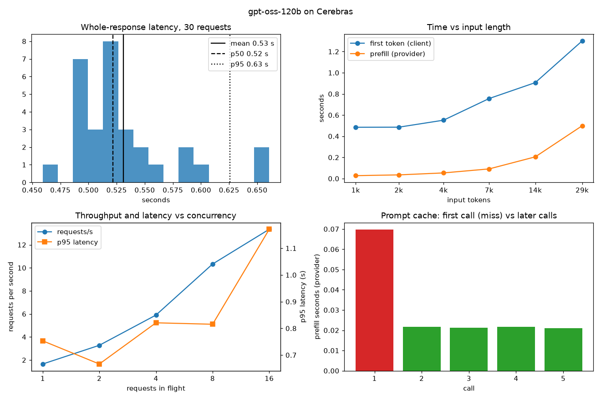
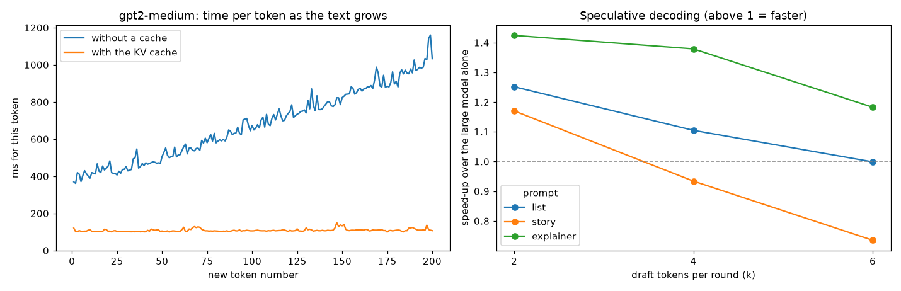
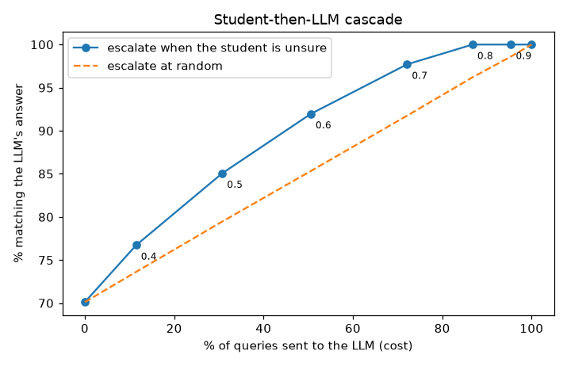

# LLM Inference Optimization

Ways to make an LLM application faster and cheaper, each measured in a runnable notebook or script:

| Folder | Technique | Where it acts | Runs |
| --- | --- | --- | --- |
| [`01_model_distillation/`](01_model_distillation/) | **Distillation:** a large LLM labels data once; a 50,000-parameter network learns to copy it and answers locally in milliseconds | Model | Notebook; 8 API calls (the labels are saved) |
| [`02_response_cache/`](02_response_cache/) | **Response caching:** exact and semantic caches in front of the model, as a LangGraph agent | Service | Notebook; about 15 API calls |
| [`03_latency_and_throughput/`](03_latency_and_throughput/) | **Measuring an API:** time to first token, percentiles, prompt length, concurrency, the provider's prompt cache, cost | Service | Script; about 230,000 tokens |
| [`04_quantization/`](04_quantization/) | **Quantization:** speed by number format, quality at 8 down to 2 bits, real int8 kernels | Model | Script; local, no API |
| [`05_kv_cache_and_speculative_decoding/`](05_kv_cache_and_speculative_decoding/) | **KV caching and speculative decoding,** implemented from scratch on GPT-2 models | Decoding | Script; local, no API |
| [`06_model_cascade/`](06_model_cascade/) | **A model cascade:** the distilled student answers first, the LLM only when the student is unsure | Service (routing) | Script; local, uses the saved labels |

The API-based parts use `gpt-oss-120b` through an OpenAI-compatible API: [Cerebras](https://cloud.cerebras.ai) when its key is set, otherwise [Groq](https://console.groq.com)'s free tier. The local parts run on a CPU.

## Repository structure

```
llm-inference-optimization/
├── 01_model_distillation/
│   ├── model_distillation.ipynb   # teacher labels, student network, training, evaluation, speed and cost (with saved outputs)
│   └── teacher_labels.json        # the teacher's labels for the 116 queries, so re-runs don't pay to label again
├── 02_response_cache/
│   └── response_cache.ipynb       # exact + semantic cache as a LangGraph agent, time to live, similarity tests, traffic simulation (with saved outputs)
├── 03_latency_and_throughput/
│   ├── llm_api_benchmark.py       # latency anatomy, percentiles, input length, concurrency, prompt cache, cost
│   ├── results_cerebras.json      # the measurements behind the results below (and a smaller Groq run)
│   ├── results_groq_quick.json
│   └── benchmark_cerebras.png
├── 04_quantization/
│   ├── quantization.py            # number formats, bits vs perplexity, int8 sentence encoder
│   └── results.json
├── 05_kv_cache_and_speculative_decoding/
│   ├── decoding.py                # KV cache on/off and speculative decoding, from scratch
│   ├── results.json
│   └── decoding.png
├── 06_model_cascade/
│   ├── cascade.py                 # student first, LLM when unsure: cost and quality at each threshold
│   ├── results.json
│   └── cascade.png
├── requirements.txt
├── .env.example                   # template for your API key
└── LICENSE
```

## Setup

1. **Clone the repository**

   ```bash
   git clone https://github.com/VinayakMokashi/llm-inference-optimization.git
   cd llm-inference-optimization
   ```

2. **Create and activate a virtual environment** (recommended)

   ```bash
   python -m venv .venv
   # Windows
   .venv\Scripts\activate
   # macOS / Linux
   source .venv/bin/activate
   ```

3. **Install dependencies**

   ```bash
   pip install -r requirements.txt
   ```

   This installs PyTorch (through `sentence-transformers`), so it can take a few minutes. The first runs also download the models they use: `all-MiniLM-L6-v2` (about 90 MB), DistilGPT2 (about 350 MB, for quantization and as the draft model) and GPT-2 Medium (about 1.5 GB, for the decoding experiments). Everything runs on a CPU.

4. **Add an API key.** Copy `.env.example` to `.env` at the repository root and fill in one key:

   ```bash
   cp .env.example .env
   ```

   ```
   CEREBRAS_API_KEY=your_cerebras_api_key_here   # used first when it is set
   GROQ_API_KEY=your_groq_api_key_here           # used when there is no Cerebras key
   ```

   The notebooks and scripts find `.env` at the repository root by themselves. It is git-ignored and never committed.

## How to run

**The notebooks:**

```bash
jupyter notebook 01_model_distillation/model_distillation.ipynb
jupyter notebook 02_response_cache/response_cache.ipynb
```

Or open them in VS Code and choose the virtual environment as the kernel, or run one from start to finish without opening it:

```bash
jupyter nbconvert --to notebook --execute --inplace 02_response_cache/response_cache.ipynb
```

Both notebooks are saved with their outputs, so you can read every result on GitHub without running anything.

**The scripts** print their results as tables; `--save` writes the measurements as JSON and `--plot` draws a chart. Run them from the repository root:

```bash
python 03_latency_and_throughput/llm_api_benchmark.py --plot benchmark.png
python 04_quantization/quantization.py
python 05_kv_cache_and_speculative_decoding/decoding.py --plot decoding.png
python 06_model_cascade/cascade.py --plot cascade.png
```

| Part | API use | Time (on the laptop CPU used here) |
| --- | --- | --- |
| Model distillation notebook | 8 calls: the labels are loaded from `teacher_labels.json` (delete it to label again: about 125 calls, ~45,000 tokens) | about 1 minute |
| Response cache notebook | about 15 calls (roughly 6,000 tokens); the traffic simulation uses a fake model | about 1 minute |
| API benchmark | 133 requests and about 230,000 tokens; `--quick` sends 45 requests and about 37,000 tokens, for Groq's free tier | about 2 minutes on Cerebras; `--quick` on Groq's free tier took about 4 minutes, mostly waiting on its rate limits |
| Quantization | none | about 1 minute, plus a 350 MB download on the first run |
| KV cache and speculative decoding | none | about 8 minutes, plus a 1.9 GB download on the first run |
| Model cascade | none: it uses the saved labels | under 30 seconds |

Useful options:

| Script | Option | What it does |
| --- | --- | --- |
| `llm_api_benchmark.py` | `--provider cerebras` / `groq` | Choose the provider (default: Cerebras if its key is set) |
| | `--only anatomy` / `input-length` / `concurrency` / `prompt-cache` | Run one experiment |
| | `--quick` | Smaller runs that fit a free tier's rate limits |
| `quantization.py` | `--only precision` / `bits` / `int8` | Run one experiment |
| | `--bits 8 6 4` | Choose the bit widths to test |
| `decoding.py` | `--only kv-cache` / `speculative` | Run one experiment |
| | `--new-tokens 100`, `--draft-tokens 2 4 6 8`, `--reps 3` | Length of the KV-cache test, draft sizes, timed repetitions |
| `cascade.py` | `--thresholds 0.5 0.6 0.7` | The confidence thresholds to compare |

## 1. Model distillation

A large model is good at classifying search queries by intent, but every call costs money and takes about half a second. Distillation uses the large model as a **teacher** that labels a set of queries once; a small **student** network then learns to copy those labels and runs locally from then on.

### How it works

```
116 search queries ─► teacher: gpt-oss-120b returns a probability for each intent (JSON) ─► teacher_labels.json
        │
        └─► all-MiniLM-L6-v2 (frozen, 384 numbers per query) ─► student: 384 → 128 → 5 ─► intent probabilities
                                                                trained to match the teacher (KL divergence, T = 3)
```

- **The task:** five intents a shop's search box might route on: navigational ("amazon login"), informational ("how does a microwave work"), transactional ("buy iphone 15 pro"), comparison ("nike vs adidas running shoes") and support ("track my order"). The queries are written without answers; the teacher provides every label.
- **The teacher:** asked for a probability for every intent, in a fixed JSON shape. Code checks each reply, rescales the five numbers to sum to 1, and asks again if a reply is unusable. The labels are saved, so the expensive step runs once.
- **Soft labels:** the student learns the teacher's full distribution ("40% informational, 40% transactional, 15% comparison"), not just its top pick.
- **The loss:** KL divergence between the student's and the teacher's distributions, both flattened with a temperature of 3 (and scaled by T²) so the small probabilities count too. Teacher probabilities below 1% are treated as 1% first: the teacher writes probabilities in steps of about 1%, and a tinier floor turned that rounding into large differences after flattening.
- **A fair test:** a quarter of the queries (29) are held out and never trained on. Section 10 also uses 4-fold cross-validation, repeated with 3 shuffles, because on 29 queries one query moves agreement by 3.4 points.

### Results

From the run saved in the [notebook](01_model_distillation/model_distillation.ipynb):

| | Teacher (API) | Student (local) |
| --- | --- | --- |
| Agrees with the teacher's top intent, unseen queries | — | **72%** (98% on its training queries; always guessing the most common intent: 24%) |
| Jensen-Shannon distance to the teacher, unseen queries | — | 0.33 |
| Time per query (median) | 471 ms | **12 ms**, of which 0.04 ms is the network and the rest the sentence encoder |
| Cost | about $0.16 per 1,000 queries at example rates | no API fee |
| Size | `gpt-oss-120b` (about 117B parameters) behind an API | 49,925 parameters, plus the 22.7M-parameter frozen encoder (about 90 MB) |

| Student trained on (cross-validated) | Agreement | Jensen-Shannon distance |
| --- | --- | --- |
| Soft labels, T = 3 | 70% | 0.347 |
| Soft labels, T = 1 | 72% | 0.341 |
| Hard labels (top intent only) | **77%** | 0.342 |

### What the results showed

- **Test on held-out data.** 98% agreement on the training queries against 72% on unseen ones: with 87 training queries the student partly memorises. Most misses are short queries such as "wikipedia" or "promo code not working".
- **Soft labels did not beat hard labels here.** The teacher's probabilities are written guesses, mostly round numbers with ties like 40/40, not the model's internal probabilities that classic distillation uses; and the data is small. This test can't say whether soft labels would win with thousands of real queries.
- **The student copies the teacher, mistakes included, and the teacher is not fully consistent:** "Samsung vs iPhone camera" got 70% comparison in one run and 80% in another, both at temperature 0.
- **"Tiny" describes the network, not the deployment.** Nearly all of the student's time and size is the sentence encoder; it still runs comfortably on an ordinary CPU.

## 2. Response cache

In most LLM applications a few questions make up most of the traffic. A response cache keeps each answer and serves it again when the same question, or one that means the same thing, comes back. The demo agent writes a short profile of a person, with two caches in front of the model, built as a [LangGraph](https://langchain-ai.github.io/langgraph/) graph:

```
query → check exact cache ──hit──→ reply
            │ miss
        check semantic cache ──hit──→ reply
            │ miss
        call the model → store the answer → reply
```

### How it works

- **Exact cache:** the key is the normalised text (lower case, no punctuation, no "'s"), so "Marie Curie!" and "marie curie" match. A dictionary lookup.
- **Semantic cache:** filler words ("tell me about", "who is") are stripped, the rest is embedded with `all-MiniLM-L6-v2`, and the closest cached question counts as a match above a cosine similarity of **0.60**.
- **Time to live:** each entry expires after `ttl_seconds` (24 hours by default; 5 seconds in the demo).
- **Guard (optional):** a semantic match is rejected if the new question has a meaningful word the cached one doesn't ("Pierre", "daughter", "mother").
- **`answer_fn`** is the model call; the traffic simulation swaps in a fake one, so it runs for free.

### Results

From the run saved in the [notebook](02_response_cache/response_cache.ipynb):

| Test | Result |
| --- | --- |
| 7 questions, with a repeat, a lowercase repeat and two rephrasings | **3 model calls**; 1.9 s instead of about 4.1 s; 694 tokens instead of about 1,600. An exact hit takes about 1.5 ms, a semantic hit 11-15 ms, a model call 500-700 ms |
| Time to live of 5 seconds | A repeat within 5 seconds came from the cache; after 6 seconds the model was called again |
| 5 similar-looking questions about other people, no guard | **3 got someone else's profile**: "Pierre Curie" and "Marie Curie's daughter" got Marie Curie's, "Elon Musk's mother" got Elon Musk's |
| Thresholds 0.5-0.9 on 8 same-person and 8 different-person pairs | At 0.6: 6 right matches and 6 wrong ones. At 0.8: 1 wrong, but only 3 right. With the guard: 0 wrong at every threshold, 6 right at 0.5-0.6 |
| 300 simulated requests (a few people far more popular than the rest), fake model | Guard on: **91% answered from the cache** (27 model calls), 0 wrong answers. Guard off: 93%, but 5 wrong: every request about Virat Kohli got Sachin Tendulkar's profile |

### What the results showed

- **Most savings come from the semantic cache:** 196 semantic hits against 77 exact ones, because people phrase the same question in many ways.
- **Deciding what counts as "similar" is the hard part.** Some wrong pairs score higher than right ones ("Venus Williams" vs "Serena Williams" 0.80; "Tell me about Elon" vs "Elon Musk" 0.62), so no threshold alone separates them. Test on labelled pairs and add a rule that fits the application.
- **Set the time to live by how fast the facts change,** and never share personal answers (orders, accounts) across users.
- **In production** the cache would live in Redis or a vector database, and its key would include the model and prompt version, so a prompt change doesn't serve old answers.

## 3. Latency, throughput and cost of an LLM API

[`llm_api_benchmark.py`](03_latency_and_throughput/llm_api_benchmark.py) measures what an application on a hosted model can see and control: how long a user waits, where that time goes, what happens with longer prompts and with more requests at once, whether the provider reuses repeated prompts, and what it all costs.

### How it works

- **Streaming requests.** Each request is streamed, so the script records the time to the first token (including gpt-oss's hidden reasoning), the time to the first token of the answer, and the total. Cerebras and Groq also report their own timings for each request (queue, reading the prompt, writing the answer), which separates the model's work from the network.
- **Percentiles, not averages.** 30 requests run one after another and are summarised as mean, p50, p95 and p99.
- **Input length.** Prompts of about 1,000 to 32,000 tokens, each starting with a unique id so the provider's prompt cache can't help.
- **Concurrency.** The same 16 copywriting requests with 1, 2, 4, 8 and 16 in flight at once, from a thread pool.
- **Prompt cache.** One 6,000-token prefix with five different questions; the provider's `cached_tokens` count shows whether the prefix was reused.
- **Cost.** `1.25 × (input tokens × input price + output tokens × output price)` per request, with the measured token counts and example prices, scaled to 10,000 users making 5 requests a day.

### Results

From the run saved in [`results_cerebras.json`](03_latency_and_throughput/results_cerebras.json) (gpt-oss-120b on Cerebras, called from a laptop over a home internet connection):



| 30 short requests | mean | p50 | p95 | p99 |
| --- | --- | --- | --- | --- |
| First token (client) | 0.484 s | 0.473 s | 0.564 s | 0.589 s |
| Whole response (client) | 0.531 s | 0.522 s | 0.626 s | 0.658 s |
| Provider's own total (queue + prompt + answer) | 0.077 s | 0.069 s | 0.107 s | 0.164 s |

| Input tokens | Prefill (provider) | Per 1,000 tokens | First token (client) | Cost (example prices) |
| --- | --- | --- | --- | --- |
| 1,021 | 0.028 s | 27 ms | 0.49 s | $0.0005 |
| 3,737 | 0.053 s | 14 ms | 0.55 s | $0.0017 |
| 7,331 | 0.091 s | 12 ms | 0.76 s | $0.0033 |
| 14,492 | 0.205 s | 14 ms | 0.91 s | $0.0064 |
| 28,960 | 0.499 s | 17 ms | 1.30 s | $0.0128 |

| Requests in flight | Total time for 16 | Requests/s | Output tokens/s | Latency p50 / p95 |
| --- | --- | --- | --- | --- |
| 1 | 9.68 s | 1.65 | 353 | 0.59 / 0.75 s |
| 4 | 2.71 s | 5.90 | 1,262 | 0.59 / 0.82 s |
| 16 | 1.20 s | 13.35 | 2,854 | 0.82 / 1.17 s |

**Prompt cache:** with a 5,539-token prompt, the second to fifth calls reused 5,504 tokens (99%), and prefill fell from 0.070 s to 0.021 s.

**Cost:** a copywriting request averaged 106 input and 214 output tokens: 1.25 × (106 × $0.35 + 214 × $0.75) / 1M = $0.00025 at the example prices, or about $371 a month for 10,000 users making 5 requests a day.

### What the results showed

- **Most of the wait was not the model.** The provider spent a median 0.07 s on each request; the client waited 0.52 s. The rest (about 85%) was the network round trip, the connection and streaming. On a fast provider, where the servers are matters more than the model's speed.
- **Percentiles tell more than the mean.** Here the spread was small (p50 0.52 s, p99 0.66 s), but the provider's own p99 (0.16 s) was more than twice its median: averages hide the slow tail that users notice.
- **Longer prompts cost linearly but slow down faster.** Billing is per token, so 28 times the input cost 27 times as much. Prefill took 18 times longer, and its time per 1,000 tokens first fell (fixed overheads spread out) and then rose from 12 ms to 17 ms between 7,000 and 29,000 tokens: attention's cost, which grows with the square of the length, starts to show. Capping prompt length at the application is the lever.
- **Concurrency raised throughput 8 times** (1.65 to 13.35 requests per second) while the median request got only 0.23 s slower: the provider runs many requests side by side. Workloads that don't need an instant answer should be sent in parallel (or through a provider's batch API, which is usually cheaper).
- **The provider's prompt cache works automatically** when the start of the prompt repeats. Keep long, stable content (system prompt, documents) at the start and the changing question at the end.
- **On a free tier, the rate limit sets the speed.** A smaller run on Groq's free tier ([`results_groq_quick.json`](03_latency_and_throughput/results_groq_quick.json), `--quick`) was a different picture. Short requests were as quick (median 0.53 s, of which a median 0.24 s was spent in the provider's queue), but prompts of 3,700 tokens waited about 24 seconds for the tokens-per-minute limit, and throughput stayed at 0.41 requests per second whether 1, 2 or 4 requests were in flight: the extra requests just waited (p95 latency 13 s at 4). This compares a free tier with a paid one, not the two providers' hardware. Groq also reported no cached prompt tokens for this model.

## 4. Quantization

[`quantization.py`](04_quantization/quantization.py) runs three experiments on a CPU, with no API key.

### How it works

- **Precision.** One 1024 × 1024 matrix multiplication in FP32, BF16 and FP16 (and on a GPU too, if one is present).
- **Bits vs quality.** DistilGPT2's 24 transformer weight matrices (42.5M of its 82M parameters; the token embeddings stay in FP32) are rounded to 8, 4, 3 and 2 bits and stored back as floats ("fake" quantization), with one scale per matrix, per output channel, or per group of 128 weights. The model's perplexity on a fixed 353-token text shows how much quality is left.
- **Real int8.** PyTorch's dynamic quantization (`torch.ao.quantization.quantize_dynamic`, int8 weights and activations in every linear layer) applied to `all-MiniLM-L6-v2`, the sentence encoder the distillation and cache notebooks depend on, with one scale per weight matrix and with one per output channel. The script measures size on disk, speed, how close the embeddings stay, and whether the response cache's decisions on its 16 labelled question pairs change.

### Results

From the run saved in [`results.json`](04_quantization/results.json), on a laptop CPU with 8 threads and no GPU:

| One 1024 × 1024 matrix multiplication | Time | Against FP32 |
| --- | --- | --- |
| FP32 | 8.3 ms | — |
| BF16 | 2,381 ms | 288× slower |
| FP16 | 2,432 ms | 294× slower |

DistilGPT2's perplexity on the test text (lower is better; FP32 gives 61.5):

| Bits | One scale per matrix | One per output channel | One per group of 128 | Size of the 42.5M weights |
| --- | --- | --- | --- | --- |
| 32 (FP32) | 61.5 | 61.5 | 61.5 | 162 MB |
| 8 | 76.4 (+24%) | 61.8 (+0.4%) | **61.5 (0%)** | 41 MB |
| 4 | 8,450 | 108.9 (+77%) | **71.9 (+17%)** | 21 MB |
| 3 | 11,352 | 764 | 292 (+374%) | 16 MB |
| 2 | 3,135 | 24,654 | 29,318 | 10-11 MB |

The sentence encoder (all-MiniLM-L6-v2) with PyTorch's int8 dynamic quantization:

| | Size on disk | 116 queries | 1 query | Similarity to FP32 (mean / lowest) | Cache decisions that flip |
| --- | --- | --- | --- | --- | --- |
| FP32 | 86.7 MB | 191 ms | 10.1 ms | — | — |
| int8, one scale per matrix | 55.9 MB | 143 ms (1.34× faster) | 15.8 ms (0.64×) | 0.950 / 0.869 | 2 of 16 |
| int8, one scale per channel | 56.3 MB | 137 ms (1.40× faster) | 15.7 ms (0.64×) | 0.977 / 0.938 | 2 of 16 |

### What the results showed

- **Lower precision is only faster where the hardware is built for it.** This CPU has no fast BF16 or FP16 arithmetic, so PyTorch falls back to slow code: half precision was about 290 times *slower*. On a GPU with half-precision units the same switch makes matrix multiplication several times faster. The speed-up belongs to the hardware and its kernels, not to the number format.
- **8 bits is close to free, if the scales are fine enough.** With one scale for a whole matrix, a few large weights stretch the scale and the small ones round away: perplexity +24%. One scale per output channel: +0.4%. One per group of 128 weights: no change, at a quarter of the size (162 MB to 41 MB).
- **4 bits needs groups, and 3 or 2 bits break this model.** Per-group 4-bit rounding kept perplexity within 17% at an eighth of the size; 3 bits made it 4.7 times worse, and 2 bits destroyed it. Calibrated methods (GPTQ, AWQ) and larger models hold up much better than plain rounding on an 82M-parameter model.
- **Real int8 on this CPU: smaller, a little faster in batches, slower one at a time.** The int8 encoder is about 1.5 times smaller (its 47 MB of token embeddings stay in FP32) and 1.3-1.4 times faster on a batch of 116 queries, but slower on a single query, where converting the activations to int8 costs more than the int8 arithmetic saves.
- **Small embedding changes flip borderline decisions.** The int8 embeddings stayed close to the originals (0.95-0.98 similarity) but moved the response cache's scores by up to 0.11. "Tell me about Elon" fell below the 0.60 threshold (a lost cache hit), and so did "Virat Kohli" against "Sachin Tendulkar" (a wrong match avoided). After quantizing a model, re-check any threshold tuned on the original.

## 5. KV caching and speculative decoding

[`decoding.py`](05_kv_cache_and_speculative_decoding/decoding.py) implements both techniques from scratch, in plain generation loops, on GPT-2 Medium (355M parameters) with DistilGPT2 (82M) as the draft model. It runs on a CPU with no API key; the first run downloads about 1.9 GB.

### How it works

- **KV caching.** Greedy generation of 200 tokens twice: re-running the model over the whole sequence at every step, and with a `DynamicCache` that keeps every layer's keys and values so each step processes only the newest token. The script times every token, checks the two texts are identical, and compares the cache's measured size with the formula `2 × layers × hidden size × bytes per value` per token.
- **Speculative decoding.** Each round, the draft proposes `k` tokens one by one; GPT-2 Medium scores all of them in one forward pass and keeps the longest prefix it agrees with, plus one token of its own. Both models keep KV caches, trimmed after each rejection. With greedy decoding the text must equal GPT-2 Medium's own, which the script checks, on three prompts of different predictability, for `k` = 2, 4 and 6.

### Results

From the run saved in [`results.json`](05_kv_cache_and_speculative_decoding/results.json), on a laptop CPU with 8 threads:



| GPT-2 Medium, 44-token prompt, 200 new tokens | First 10 tokens | Last 10 tokens | Total |
| --- | --- | --- | --- |
| Without a cache | 402 ms per token | 1,007 ms per token | 135.2 s |
| With the KV cache | 104 ms per token | 110 ms per token | **22.1 s** |

The cache made generation **6.1 times faster**, with identical text. Its size is 2 (keys and values) × 24 layers × 1,024 values × 4 bytes = 192 KiB per token: 45.8 MiB measured after 244 tokens, exactly as the formula says, and 192 MiB for one sequence at the model's full 1,024-token context.

| Prompt (80 new tokens) | GPT-2 Medium alone | k = 2 | k = 4 | k = 6 |
| --- | --- | --- | --- | --- |
| List of capitals | 8.66 s | 1.25× (68% of draft tokens accepted) | 1.10× (54%) | 1.00× (43%) |
| Story | 8.42 s | 1.17× (61%) | 0.93× (43%) | 0.74× (29%) |
| Refrigerator explainer | 9.42 s | **1.42×** (77%) | 1.38× (64%) | 1.18× (51%) |

In all 9 settings the text was identical to what GPT-2 Medium wrote on its own.

### What the results showed

- **Without a cache, every token costs more than the last.** The time per token grew from 0.4 s to 1.0 s over 200 tokens, because each step reprocesses the whole text; with the cache it stayed at about 0.1 s. The price is memory: 192 KiB per token for this small model, growing with the number of layers, the width, the context length and the number of requests served at once. That is why providers manage KV-cache memory so carefully (vLLM's PagedAttention, for example).
- **Speculative decoding never changed the text** and was up to 1.42 times faster, with 2 draft tokens per round.
- **It pays only when the draft is cheap and usually right.** Acceptance fell as `k` grew, since every extra guess is less likely to match, and on this CPU the draft's own cost (about a quarter of GPT-2 Medium's compute per token) ate the gain: with 6 draft tokens, the story ran at only 0.74 times the large model's own speed. On a GPU, checking several tokens costs about the same as producing one (the large model is limited by memory bandwidth, not arithmetic), so the same acceptance rates buy more.
- **Tokens per large-model pass is the hardware-independent number.** Here it was 2.2 to 3.6: the large model ran 2.2 to 3.6 times fewer forward passes for the same text.

## 6. A model cascade

[`cascade.py`](06_model_cascade/cascade.py) combines the two models from section 1: the distilled student answers every query, and only the queries where it is unsure go to the LLM. It needs no API calls, because the LLM's labels, latencies and token counts for all 116 queries are already in `01_model_distillation/teacher_labels.json`.

### How it works

- **Honest student predictions.** The student is trained exactly as in the distillation notebook, with 4-fold cross-validation repeated over 3 shuffles, so every query is judged by a student that never trained on it.
- **A confidence threshold.** A query goes to the LLM when the student's top probability is below the threshold. For each threshold the script reports the share sent to the LLM, how often the cascade's answer matches the LLM's, the cost per 1,000 queries, and the mean latency, and compares with sending the same share of queries chosen at random.

### Results

From the run saved in [`results.json`](06_model_cascade/results.json):



| Send to the LLM when the student's top probability is below | Sent to the LLM | Matches the LLM | Same share sent at random | Cost per 1,000 queries | Mean latency |
| --- | --- | --- | --- | --- | --- |
| never (student only) | 0% | 70% | 70% | $0 | 10 ms |
| 0.5 | 31% | 85% | 79% | $0.051 | 158 ms |
| 0.6 | 51% | 92% | 85% | $0.083 | 254 ms |
| 0.7 | 72% | **98%** | 92% | $0.118 | 358 ms |
| 0.8 | 87% | 100% | 96% | $0.143 | 428 ms |
| always (LLM only) | 100% | 100% | 100% | $0.164 | 492 ms |

Costs use the same example prices as the distillation notebook; latencies use the LLM's recorded call times and the student's measured 10 ms.

### What the results showed

- **The student's confidence carries information.** At every threshold, sending the queries the student is unsure about beats sending the same number at random: 92% against 85% at 0.6.
- **0.7 matched the LLM on 98% of queries while sending it 72% of them:** 28% cheaper and 27% faster on average than always calling the LLM. A threshold of 0.6 gave 92% for about half the cost and half the wait.
- **The cascade is only as good as its student.** Trained on 87 queries per fold, the student's top probability is below 0.6 for half of all queries. More real training data would let it keep more queries at the same quality.
- **The threshold is a business decision:** how much disagreement with the LLM is acceptable for how much saving. It should be chosen on separate data and re-checked when the traffic or the LLM changes.

## Tech stack

- Python 3.10+ (tested on 3.12)
- `openai` SDK, pointed at Cerebras or Groq (both OpenAI-compatible), and `python-dotenv`
- `sentence-transformers` (`all-MiniLM-L6-v2`) and PyTorch for the embeddings and the student network
- `transformers` for the local GPT-2 models (GPT-2 Medium, DistilGPT2) and their `DynamicCache`
- PyTorch's `torch.ao.quantization` for int8 dynamic quantization (PyTorch marks it as deprecated in favour of `torchao`; it still works in the PyTorch 2.x versions tested here)
- NumPy and SciPy (Jensen-Shannon distance), pandas and matplotlib
- LangGraph for the cache agent's graph
- Jupyter to run the notebooks

## Limitations

- **Small, hand-written data.** 116 search queries and one teacher run for distillation; a dozen questions, 16 labelled pairs and a simulated stream of requests about 20 people for the cache. Both show the method and its pitfalls, not production numbers.
- **Written probabilities, not logits.** The teacher's soft labels are numbers the model writes in its reply. An open model run locally could expose its real output probabilities instead.
- **A simple cache.** An in-memory dictionary, compared against every entry on each lookup; the guard is a rule for name lookups and would need rethinking for other applications; descriptions such as "Nvidia CEO" never match a name.
- **One machine, one network, one moment.** The API numbers come from one run from one connection; latency varies with the time of day, the route to the provider and its load. The local numbers come from one laptop CPU (8 threads, with no hardware support for fast BF16/FP16 arithmetic and only basic int8 instructions); on a GPU, half precision and int8 are much faster, and speculative decoding pays off more when the large model is limited by memory bandwidth.
- **Simple quantization.** Plain round-to-nearest with absolute-max scales on a small model. Methods that calibrate on data (GPTQ, AWQ) keep far more quality at 4 bits, and large models tolerate rounding better than an 82M-parameter one.
- **Greedy decoding only.** The speculative decoder checks the draft against the large model's top choice. Sampling needs the probabilistic accept/reject rule from the speculative decoding papers.
- **The cascade is simulated on its own data.** The LLM's answers are the saved labels, and the thresholds are compared on the same 116 queries they are reported on; a real deployment would pick the threshold on separate data.
- **Example prices.** Token rates are illustrative; check your provider's current prices.

## License

Released under the [MIT License](LICENSE).
